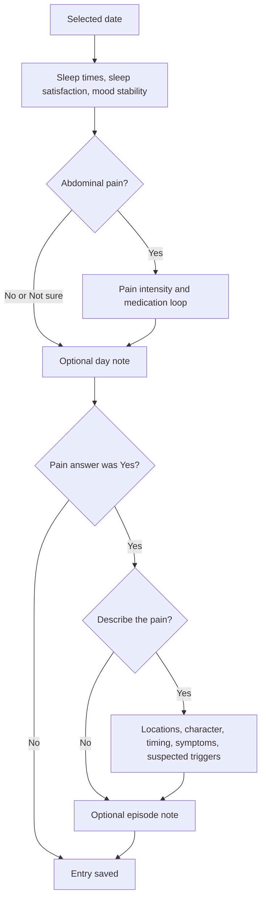

# FoodBot — Daily Note, Pain Description, and Export Specification

**Date:** 1 November 2026  
**Deliverable:** English product and implementation specification, not a claim that the features below are implemented.  
**Project inspected:** `C:\Users\Влад\Desktop\Проекты\FoodBot`  
**Implementation style:** Extend the existing Python / aiogram / SQLite project with small functions and modules grouped by responsibility. Keep `Archive` excluded from reading, searching, tests, and changes.

## 1. Purpose and boundaries

Help the user record sleep, mood stability, abdominal pain, medication use, and useful personal observations. The record should be easy to review and later share with a doctor as an XLSX workbook.

The wider product also aims to support regular sleep, meal times and meal gaps, food notes, and possible links between habits and well-being. Meal logging and calorie estimation are **future work**: the daily questionnaire below does not collect enough information to calculate either. A suspected food trigger is not a meal log.

Use a structured symptom-history questionnaire. Do not present the bot as a clinician, diagnose a condition, recommend medication or doses, or state that a suspected trigger caused a symptom. The symptom-description categories follow the kinds of history described by the [American College of Gastroenterology](https://gi.org/topics/abdominal-pain/); the screen order, interaction rules, and storage design below are product decisions.

## 2. What is already in the project

These findings come from source files and project documentation, not from inspecting users' database records or running the bot:

| Area | Existing implementation | Change specified here |
| --- | --- | --- |
| Calendar | Past/current dates only; opening a month selects no date; a selected day shows four core properties. | Keep that overview; add a read-only full-entry view for detailed answers. |
| Questions | Bedtime, waking time, sleep satisfaction 1–10, mood stability 1–10, pain, medicines, optional notes. | Refine date wording and fill the detailed-pain placeholder. |
| Saving | Each accepted answer is committed immediately; `next_step` supports resuming. | Preserve immediate saving, including partially completed multi-select questions. |
| Recorded answers | The bot edits the original question, appends `Answer recorded` and the value, then sends the next question. | Preserve this visible confirmation while limiting retained working messages. |
| Pain description | `pain_description_requested = Yes` currently displays a placeholder and skips the detail questions. | Replace that placeholder with section 6. |
| Medicines | Repeated rows with a combined name/dose description and a relief answer. | Preserve old raw descriptions; support separate name/dose fields and safe editing by row ID. |
| Reminders | Profile-based fixed UTC offset; local reminder hour, 24-hour inactivity rule, at most one attempt per local day. | Keep these rules; only finishing an entry refreshes completion time. |
| Legacy data | `calendar_answers` contains Yes/No; `day_ratings` contains sleep/food/mood 1–7. | Preserve both unchanged and label their original scales in exports. |

The current `day_storage.py` deletes medication rows when some branch answers change and can replace the medication list when entering the first medicine again. The proposed implementation must remove those silent data-loss paths. The existing statistics use available saved values, including partial entries; make that basis visible rather than silently changing it.

Read `AGENTS.md`, `Readmes/AGENTS.md`, `Readmes/DAY_FLOW_PLAN.md`, and `Readmes/README.md` before implementing. This document proposes extensions to the approved daily flow; it does not authorize unrelated features or a framework rewrite.

## 3. Date, scale, and completion rules

- A note belongs to the **selected local calendar date**, called `D`. Every screen shows that date. For historical notes, use the actual date instead of the ambiguous words “today” and “yesterday.”
- The sleep entry is the main sleep period **ending on D**. Show both bedtime and waking dates. Default the bedtime date to `D − 1`, but provide a button to choose `D` for a bedtime after midnight. Do not silently infer an unconfirmed bedtime date.
- Accept time buttons and exact typed `HH:MM` using the existing 24-hour format. Normalize `8:00` to `08:00`.
- Save each time as soon as it is accepted, even if the other time is still missing. Do not calculate an interval until both dates and times are known. Ask the user to correct or confirm inconsistent dates; never silently wrap a negative interval.
- Bedtime-to-waking time is a **self-reported sleep window**, not a measurement of time actually asleep. Use that wording in the export.
- Keep the current fixed-UTC-offset profile model for this stage. Snapshot the offset used for the entry so changing the profile later does not shift old dates. Do not claim automatic daylight-saving support.
- Display the offset beside event date/time inputs. For a historical entry, let the user confirm it, change it, or leave it unknown; the user's current profile offset is not proof of their location/offset on a past date.
- Sleep satisfaction: `1 = very dissatisfied`, `10 = very satisfied`.
- Mood **stability**, not happiness or diagnosis: `1 = extremely unstable`, `10 = very stable`. The existing database name `mood_control` may remain, but show the clearer label to users and doctors.
- Pain intensity: `1 = very mild`, `10 = the strongest pain you have personally experienced`. This is a personal comparison, not a validated clinical assessment. Pain absence is a separate No answer, not a fabricated intensity of zero.
- Support `Not sure` where recall is uncertain. Optional detail questions also have `Skip`. Store these states distinctly from No and an unanswered question.
- `completed = 1` means that the user reached the end of the relevant dialogue. It does not mean that every optional detail is available. A report must show missing/unknown fields honestly.
- Viewing a date, full entry, calendar, or statistics must not change answers, completion status, or reminder timing. UI bookkeeping is separate from health answers.
- Collect and display personal diary answers in the user's private chat. Do not reveal saved health data through a button pressed in a group chat.

## 4. Complete question flow

Use short English questions. Each accepted answer uses the recorded-answer display defined in section 7.



| Step / stable key | User-facing question | Input | Next step |
| --- | --- | --- | --- |
| `bedtime` | What time did you go to bed to sleep? Bedtime date: **[date]**. | Hour buttons or `HH:MM`; button to change the displayed bedtime date; `Not sure`. | Waking time. |
| `wake_time` | What time did you wake up on **[D]**? | Hour buttons or `HH:MM`; `Not sure`. | Show the saved sleep window in the receipt, then sleep satisfaction. |
| `sleep_satisfaction` | How satisfied were you with your sleep? | Buttons 1–10, with scale labels; `Not sure`. | Mood stability. |
| `mood_control` | How stable was your mood throughout **[D]**? | Buttons 1–10, with scale labels; `Not sure`. | Abdominal pain. |
| `ache` | Did you have abdominal (tummy) pain on **[D]**? | `Yes`, `No`, `Not sure`. | Yes → intensity. No/Not sure → optional day note. |
| `pain_intensity` | At its worst that day, how intense was the pain compared with the strongest pain you have ever felt? | Buttons 1–10; `Not sure`. | Painkiller question. |
| `painkillers` | Did you take any painkillers for this pain? | `Yes`, `No`, `Not sure`. | Yes → medication loop. No/Not sure → other-medication question. |
| `other_medicine_wanted` | Did you take any other medicine for these symptoms? | `Yes`, `No`, `Not sure`. | Yes → medication loop. Otherwise → day note. |
| `medicine_name` | Which medication did you take? | Short text; `Not sure`. | Dose. |
| `medicine_dose` | What dose did you take? Include the amount and unit if known. | Text such as `1 tablet, strength unknown` or `200 mg`; `Not sure`. | Optional time. |
| `medicine_time` | When did you take it? | Date/time input; `Not sure`, `Skip`. | Relief. |
| `medicine_relief` | Did it help? | `Yes`, `No`, `A little`, `Not sure`. | Another medication/dose. |
| `more_medicine` | Did you take another medication or another dose? | `Yes`, `No`. | Yes → a new medication row. No → medication-list receipt, then day note. |
| `day_comment_wanted` | Would you like to add a note about the day? | `Yes`, `No`. | Yes → day-note text. No → pain-detail offer if pain was Yes, otherwise completion. |
| `day_comment` | Please write a short note about the day. | Text up to 1,000 characters; `Skip`. | Pain-detail offer if pain was Yes, otherwise completion. |
| `pain_description_requested` | Would you like to describe the pain and what happened around it? | `Yes`, `No`. | Yes → section 6. No → optional episode note. |
| `pain_comment_wanted` | Would you like to add a note about the pain episode? | `Yes`, `No`. | Yes → episode-note text. No → completion. |
| `pain_comment` | Please write a short note about the pain episode. | Text up to 1,000 characters; `Skip`. | Completion. |

### 4.1 Branches that must remain unambiguous

- The optional **day note is offered on both pain and no-pain paths**.
- If pain was No, pain intensity, pain medicines, pain details, and episode note are not applicable; do not ask them.
- If pain was Not sure, do not silently record No. End through the day-note path and mark the unasked pain-specific questions `not_asked`, with the uncertain parent answer visible. This is different from pain No making those questions not applicable.
- A No to painkillers does not prove that no other medicine was taken. This is why the short other-medication question is included.
- A No to detailed pain description skips only section 6. The optional episode note is still offered.
- If the user declines either note, show `Answer recorded\nNo` for the offer. Do not create a meaningless empty text message.
- All inputs are self-reports. “Helped” and “suspected trigger” do not establish treatment efficacy or causation.

### 4.2 Medication loop

Separate name and dose for new records so the future workbook has readable columns. This is a refinement of the existing combined-text question; preserve every existing combined description verbatim.

Save the medication row immediately after its first answer, assign a stable `medication_id`, and update that same row for its dose/time/effect. If the user leaves halfway through, retain the incomplete row and resume at its missing question. Do not create it twice after a repeated callback or a network retry.

An intentional additional dose is a new row, even for the same medication. Its time can remain unknown. Do not guess medication strength, convert tablets to milligrams without supplied strength, or suggest a dose.

When the loop ends, show the following as one paginated, read-only receipt if needed:

```text
All recorded medications — 01.11.2026
1. [name] — [dose exactly as recorded]
   Taken: [time / Not sure / Not recorded]
   Helped: [Yes / No / A little / Not sure / Not answered]
2. ...
```

Show all saved rows, including a clearly labeled incomplete row. Add `Continue` to the next question; do not send an extra message for every row. If no medicines were reported, a short “No medicines reported for this pain” line is sufficient.

## 5. Editing, pausing, and resuming

This specification deliberately preserves **immediate saving**, replacing the older three-rating prototype's all-at-once draft rule.

1. `Edit the day` resumes an incomplete entry at `next_step`. For a completed entry, begin the existing review/edit flow with saved values visible; opening it alone must not alter the note.
2. Each actual accepted replacement answer is saved immediately. Pausing does **not** roll it back. Label `Cancel` more clearly as `Pause and return`, with the text “Answers already recorded will be kept.”
3. Once an actual edit starts, mark the run incomplete until its relevant questions finish. Do not refresh `last_entry_at` for a partial edit, a view, or a pause.
4. When a text note already exists, replace the generic Yes/No offer with `Keep saved note`, `Replace`, and an explicit `Remove note`. Keep leaves the note and its saved gate unchanged; Remove deliberately clears the current text and records that choice. Merely declining to type a replacement must not erase it.
5. Existing medicines must first be shown with `Keep list`, `Add medication`, and `Edit/remove medication`. Target a specific ID. Do not delete the entire list when reopening the first medication question.
6. If a new parent answer conflicts with existing data—for example, changing pain Yes to No when medicines/details are saved—show what will be excluded and ask for confirmation. On confirmation, mark dependent items inactive and mark their question states not applicable. Do not silently destroy them. If declined, keep the original parent answer.
   A change from painkillers Yes to No must not automatically invalidate the entire medication list: other symptom-related medicines may still apply. Ask the user to review the list.
7. Current summaries/averages/export rows must not treat inactive dependent data as current. A later change back to Yes must ask whether to restore those items; never restore silently.
8. This stage need not implement a full edit-history engine. Keeping inactive medication/choice rows does not constitute a complete audit trail for overwritten scalar answers. Do not claim otherwise.
9. Old buttons must not save again. Check the user, date, active session token, question key, message ID, and expected saved step. Serialize a user's answer handling so double taps cannot create duplicate medication rows.

## 6. Detailed pain-description questionnaire

### 6.1 Scope and wording

For this stage, describe the **worst episode on D**. Say this explicitly. If there were several distinct episodes, let the user mention the others in the episode note; do not combine their different times/locations into a falsely precise single history. A future multi-episode UI can extend the model after separate approval.

The ACG describes location, character, time course, spread, associated symptoms, and relationships with eating/bowel movements as useful history. The options below collect those observations without assigning a diagnosis. [Source](https://gi.org/topics/abdominal-pain/)

### 6.2 Questions and choices

| Key | Question | Answer choices / behavior |
| --- | --- | --- |
| `pain_locations` | Where did you feel the pain? You can select more than one area. Right/left mean **your** right/left. | Upper right; upper middle; upper left; middle right; around the belly button; middle left; lower right; lower middle/pelvis; lower left; all over the abdomen; another body area; Not sure; Skip. Use a clear 3×3 abdominal-area layout plus the extra choices. |
| `pain_radiation` | Did the pain spread to another area? Select all that apply. | Did not spread; back; chest; shoulder; groin; another area; Not sure; Skip. For Other, accept a short description. |
| `pain_qualities` | What did the pain feel like? Select all that apply. | Cramping; sharp/stabbing; dull/aching; burning; pressure/fullness; throbbing; other; Not sure; Skip. |
| `pain_pattern` | Was it constant, or did it come and go? | Constant; came and went; came in waves; Not sure; Skip. |
| `pain_start` | About when did this episode start on [D]? | `HH:MM`; Not sure; Skip. Allow choosing another explicit date if it began before D. Do not use the answer's submission time as the episode start. |
| `pain_duration` | About how long did it last? | Under 15 minutes; 15–60 minutes; 1–4 hours; over 4 hours; still ongoing **now**; Not sure; Skip. Offer “still ongoing now” only for a current-day episode. Keep buckets as buckets, not invented exact minutes. |
| `pain_symptoms` | What other symptoms did you notice during the episode? Select all that apply. | Bloating/gas; nausea; vomiting; diarrhoea; constipation; heartburn; reduced appetite; fever/feeling feverish; dizziness/fainting; pain when urinating; blood in vomit; blood in stool; black sticky stool; difficulty breathing; other; None; Not sure; Skip. |
| `pain_meal_relation` | How did the pain relate to eating? | Started before eating; started while eating; started after eating; eating seemed to make it worse; eating seemed to ease it; no clear relationship; Not sure; Skip. This is a single best description, not a proven cause. |
| `pain_bowel_relation` | Did passing stool change the pain? | Eased it; worsened it; no noticeable change; no bowel movement during the episode; Not sure; Skip. |
| `pain_triggers` | What do you think may have contributed? These are your suspicions, not confirmed causes. Select all that apply. | A particular food/drink; a larger meal than usual; a long gap/skipped meal; eating late; stress; poor/short sleep; physical activity; a medicine/supplement; menstrual period if relevant; another factor; no clear trigger; Not sure; Skip. |
| `trigger_note` | Would you like to name the foods/drinks or explain the suspected triggers? | Optional text up to 1,000 characters; Skip. Offer after one or more trigger selections, including Other. |

For a reported fever, optional `measured_temperature` can ask for a measured value in °C, `Not measured`, or `Skip`. Keep “felt feverish” separate from a measured temperature. Do not add unrequested diagnostic questions automatically.

After these questions, continue to the optional episode note and then completion. Delete the existing placeholder message and its skip-only transition from the proposed implementation.

### 6.3 Multi-select behavior

- Use checkbox-style labels such as `☑ Nausea` / `☐ Nausea` and a `Done` button. A tap toggles one item; it must not advance to the next question.
- Commit each toggle immediately, keep `next_step` on this question, and edit the same message to show `Selections saved so far` plus the current list. The question remains incomplete until `Done`, `None`, `Not sure`, or `Skip` is confirmed.
- `Done` changes that message to the final `Answer recorded` receipt. Reject an empty Done with a short callback hint; do not interpret it as None.
- None/no-clear-trigger, Not sure, and Skip are mutually exclusive with selected positive options. “All over the abdomen” is mutually exclusive with individual abdominal areas. Changing a selection deactivates the previous incompatible choice in the same transaction.
- For Other, collect the short description, save it with the selected group, then return to the same checkbox screen. Allow several distinct Other descriptions when needed.
- On pause/restart, reload the saved selections and their in-progress status. Do not advance or silently discard them.

### 6.4 A short, relevant safety response

The diary must not delay urgent care. If a user reports a potentially urgent feature, show a single concise notice within the active screen; do not generate a diagnosis or a long triage conversation. For example:

```text
If this is happening now—sudden severe abdominal pain, vomiting blood,
black sticky stool or a lot of bleeding, fainting, chest pain, or trouble
breathing—seek urgent medical help. Do not wait to finish this diary.
```

Use applicable local emergency guidance rather than hard-coding a UK phone number. Keep the entry resumable and allow pausing immediately. A symptom-free answer is not an “all clear.” These are selected warning features, not a complete triage algorithm. The warning is based on [NHS abdominal-pain guidance](https://www.nhs.uk/symptoms/stomach-ache/) and the [ACG overview](https://gi.org/topics/abdominal-pain/). Chest pain/fainting should also be treated as concerning symptoms rather than classified by the diary.

## 7. Recorded-answer display and a clean Telegram chat

### 7.1 Exact confirmation pattern

Use the original **bot question message**, not the user's typed message. First commit the answer and next step to SQLite; only then edit the question:

```text
Selected day: 01.11.2026

How satisfied were you with your sleep?
1 = very dissatisfied, 10 = very satisfied.

Answer recorded
10/10
```

For the two sleep inputs, keep each answer's own confirmation and include the full window once both are known:

```text
What time did you wake up on 01.11.2026?

Answer recorded
08:00
Sleep window: 31.10.2026 21:00 – 01.11.2026 08:00
```

For a multi-select, list every saved item on separate lines, not an internal Python list or callback code. Show the exact saved note/dose text, escaped for Telegram formatting. Do not rewrite a user's symptom description into a medical conclusion.

### 7.2 Message lifecycle

**Default: keep the most recent answer receipt and one active question.** Full history lives in the database and read-only full-entry view, not dozens of messages.

| Event | Edit | Delete, best effort | Leave visible |
| --- | --- | --- | --- |
| Open/select a calendar date or navigate a month | Use the existing calendar screen behavior; if deletion is forbidden, edit the existing screen. | Only the tracked previous navigation screen, following existing project behavior. | One current calendar screen. |
| Start/resume the diary | Replace the tracked calendar screen with the relevant question. | Superseded session navigation screen only. | Current question and, when available, the latest receipt. |
| Accept a button answer | Edit that question to question + `Answer recorded` + value; remove its input buttons. Then send one next question. | Previous receipt only after the new receipt is visible. | Latest receipt + one next question. |
| Accept typed time/note/medicine text | Edit the bot's question to include the saved text. | The matching submitted user input only after its full text is saved and visibly mirrored; then the previous receipt. | Latest receipt + one next question. |
| Invalid input | Edit the active question to add one short validation hint; keep its controls. | Only a tracked invalid input if its removal is possible and appropriate. | The same question, without a new error-message chain. |
| Checkbox toggle | Edit the same question and its selection summary. | Nothing required. | Same question with current saved selections. |
| End medication loop | Use one medication-list receipt with pagination and Continue. | Superseded receipt after the list appears. | One list screen; do not flood the chat with one message per medicine. |
| Pause | Remove active answer buttons and replace the active screen with a compact saved-progress/calendar screen. | Previous working receipt when safe. | “Progress saved” and a path back to the entry. |
| Finish | Keep the final question and its recorded answer, append `Entry saved!` plus the compact day summary and navigation buttons in that same message. | Previous receipt after final confirmation appears. | One completion screen. |
| View full entry / paginate / return | Edit one read-only detail screen or replace the tracked navigation screen using the existing helper. | Its superseded navigation screen only. | One detail or calendar screen, without starting an edit. |

Only delete message IDs tracked as part of this bot interaction. Never sweep chat history or delete unrelated user messages. Do not delete an original typed answer when the receipt could not be shown.

Telegram deletion has time/permission limits, including the usual 48-hour limit. If cleanup fails, leave an inert old message and continue; a perfectly bounded history cannot be guaranteed. Catch expected “not modified / not found / cannot delete” cases separately from network/storage failures. A database error must never produce `Answer recorded`. [Telegram message editing](https://core.telegram.org/bots/api#editmessagetext), [message deletion](https://core.telegram.org/bots/api#deletemessage)

Keep ordinary text screens under a conservative 3,500-character target. Telegram text messages allow up to 4,096 characters after entity parsing; long lists/full entries should use pages edited in one screen, not silent truncation. A shortened preview must link to the full saved text. [Telegram sendMessage](https://core.telegram.org/bots/api#sendmessage)

### 7.3 Failure and retry order

1. Validate the answer and active session.
2. In one transaction, save the value/selection/medicine change, its answer state, and `next_step`.
3. Edit the current bot question into its saved-answer receipt; if it was deleted, create one replacement receipt and track its ID.
4. After that visible success, clean up the previous receipt and safely mirrored typed input.
5. Send the next question and track its message ID. Answer callback queries promptly so Telegram's loading indicator ends.

If Telegram fails after the commit, keep the saved database progress. Reopening the entry continues from `next_step`; do not add the medication or count the answer again. If Telegram fails before the next question appears, offer continuation when connectivity returns. Do not automatically roll back a successfully recorded health answer because a message edit failed.

## 8. Viewing, completion, calendar, and statistics

### Calendar overview

Keep the existing four properties above the calendar buttons:

```text
Selected day: 01.11.2026
Sleep time: 31.10 21:00 – 01.11 08:00
Sleep satisfaction: 8/10
Mood stability: 7/10
Abdominal pain: Yes
```

Keep `Edit the day` as a full-width button. Add `View full entry` as a separate read-only action for medicines, pain details, symptoms, suspected triggers, and notes. Keep the existing Calendar/Statistics navigation and neutral month-opening behavior. Do not insert sensitive long notes and medicine lists into every calendar overview.

### Full entry

Show date, completion state, the four core properties, worst pain intensity, all medication rows, detail answers, day note, and episode note. Label missing, unknown, skipped, and not-applicable values. Show lists in full through pagination. Returning to Calendar uses the existing neutral month view. Viewing must not mark the entry complete or start a questionnaire.

### Completion

Final text contains `Entry saved!`; the last receipt still contains its question and `Answer recorded` value. Buttons: `Calendar`, `Statistics`, and `View full entry`. Only this successful completion updates the entry's completed timestamp and the profile's last completed-entry time used by reminders.

The existing ✅ means “dialogue completed.” Unfinished/resumable entries keep the existing unmarked day style. Do not reinterpret the icon as “healthy day” or “no symptoms.”

### Statistics

Keep the existing monthly view: completed-entry count, sleep-satisfaction mean, mood-stability mean, and number of days reporting pain. Label the sample size for each metric and that available saved answers may include unfinished entries. Unknown/unanswered values are excluded, not replaced with zero. Keep old 1–7 ratings separate from 1–10 values. Show suspected triggers as self-reported labels if a later summary is approved; do not infer causation from the diary.

## 9. SQLite design for reliable records and a later doctor export

### 9.1 Continue the current database

Keep `data/calendar.sqlite3`, `aiosqlite`, and ordinary SQL functions. Do not introduce an ORM, replace the database, or create a generic survey framework. Do not read personal production rows to develop this change.

Existing tables:

| Table | Preserve / extend |
| --- | --- |
| `calendar_answers` | Preserve old Yes/No data unchanged. |
| `day_ratings` | Preserve old sleep/food/mood 1–7 data unchanged. |
| `user_profiles` | Preserve setup, fixed offset and reminder settings. Do not export `chat_id` by default. |
| `diary_entries` | Keep one row per `(user_id, entry_date)`, existing answers, `next_step`, and `completed`; add typed detail/date/provenance fields. |
| `day_medications` | Keep stable IDs and raw `description`; add structured columns for new inputs. |

Add only three small supporting tables: `day_pain_choices`, `day_answer_states`, and `diary_ui_sessions`. The first stores multiple selections, the second distinguishes missing-answer states, and the third tracks the small amount of UI state needed for safe cleanup/resume. These are fixed-purpose tables, not a new application architecture.

### 9.2 Extend `diary_entries`

Keep the current columns as the source for the existing core answers. Add the following nullable columns through a versioned migration; defaults must not fabricate historical facts:

| Columns | Type / meaning |
| --- | --- |
| `form_version` | INTEGER, default 1 for existing rows; new flow uses 2. Preserve the version in reports. |
| `utc_offset_minutes` | INTEGER; snapshot of profile offset when new data are recorded. Leave unknown for old entries unless separately verified. |
| `bedtime_date`, `wake_date` | TEXT `YYYY-MM-DD`; paired with existing `bedtime` / `wake_time` `HH:MM` values. Only populate from confirmed dates. |
| `other_medicine_wanted` | INTEGER, nullable Yes/No; unknown is represented by its answer state. |
| `pain_pattern` | TEXT controlled code: `constant`, `intermittent`, `waves`. |
| `pain_start_date`, `pain_start_time` | TEXT date and `HH:MM`; optional actual reported onset, not submission time. |
| `pain_duration_code` | TEXT: `under_15m`, `15_60m`, `1_4h`, `over_4h`, `ongoing_now`. |
| `pain_meal_relation` | TEXT controlled code corresponding to section 6 choices. |
| `pain_bowel_relation` | TEXT controlled code corresponding to section 6 choices. |
| `measured_temperature_c` | REAL, nullable; only a user-reported measured temperature. |
| `trigger_note` | TEXT, optional verbatim explanation of suspected triggers. |
| `created_at_utc`, `updated_at_utc`, `completed_at_utc` | TEXT ISO-8601 UTC with `Z`, nullable for historical rows lacking timestamps. |

The detailed fields describe one worst episode for that day. Do not create a misleading episode count or manufacture additional episodes. A future multiple-episode feature would move these details under explicit episode IDs through a separate approved migration.

`completed_at_utc` records the last successful completion of the entry. It may remain after a new partial edit; the separate `completed` flag describes the current run. Label the exported timestamp “Last completed at,” and do not treat it as proof that the current edited run is finished.

Store local event dates/times plus the offset snapshot as the source of truth. Derive UTC event times only when all components are known. Submission timestamps are independent and must never substitute for missing sleep, pain, or medication times. Fixed-offset history must not be silently upgraded to an assumed IANA time zone.

### 9.3 Extend `day_medications`

| Column | Type / rule |
| --- | --- |
| Existing `id`, `user_id`, `entry_date`, `description`, `relief` | Preserve. `description` remains the raw legacy text; existing relief codes stay `yes`, `no`, `a_little`. |
| `medicine_name`, `dose_text` | TEXT, nullable; new explicit answers. Never automatically split an ambiguous legacy description. |
| `taken_date`, `taken_time` | TEXT, nullable; explicit reported local date/time using the entry's offset. |
| `row_state` | TEXT: `legacy`, `incomplete`, `complete`, `removed`. Existing rows default to `legacy`. |
| `client_answer_id` | TEXT, nullable; stable operation token for retry-safe row creation. A deliberately new dose has a new token. |
| `created_at_utc`, `updated_at_utc` | TEXT UTC, nullable for legacy rows. |

Use an index on `(user_id, entry_date)` and a UNIQUE index on `(user_id, entry_date, client_answer_id)`. Null tokens allow unchanged old rows. Unknown relief remains SQL NULL with an explicit `unknown` answer state, not a new value that violates the existing relief CHECK constraint.

For a new structured row with no combined original input, keep the existing NOT NULL `description` as an empty string; the supplied name/dose live in their own columns. Do not manufacture a raw quote. Keep every legacy nonempty description unchanged.

Create a new medication row once, then update by **ID + user ID + date**. Do not update “the latest medication row” as a substitute for the active medication ID. A dose may be text without a known strength; preserving it accurately is better than guessing a numeric dose.

### 9.4 New tables — concrete DDL

Run these definitions only after the existing tables are present. Execute `PRAGMA foreign_keys = ON` on **every connection before starting its transaction**; SQLite foreign-key enforcement is connection-specific. [SQLite foreign-key documentation](https://www.sqlite.org/foreignkeys.html)

```sql
CREATE TABLE IF NOT EXISTS day_pain_choices (
    id INTEGER PRIMARY KEY AUTOINCREMENT,
    user_id INTEGER NOT NULL,
    entry_date TEXT NOT NULL,
    group_key TEXT NOT NULL CHECK (
        group_key IN ('location', 'radiation', 'quality', 'symptom', 'trigger')
    ),
    option_code TEXT NOT NULL,
    option_label TEXT NOT NULL,
    custom_text TEXT NOT NULL DEFAULT '',
    is_active INTEGER NOT NULL DEFAULT 1 CHECK (is_active IN (0, 1)),
    recorded_at_utc TEXT NOT NULL,
    updated_at_utc TEXT NOT NULL,
    FOREIGN KEY (user_id, entry_date)
        REFERENCES diary_entries (user_id, entry_date) ON DELETE CASCADE,
    UNIQUE (user_id, entry_date, group_key, option_code, custom_text)
);

CREATE TABLE IF NOT EXISTS day_answer_states (
    user_id INTEGER NOT NULL,
    entry_date TEXT NOT NULL,
    question_key TEXT NOT NULL,
    answer_state TEXT NOT NULL CHECK (answer_state IN (
        'in_progress', 'answered', 'none', 'unknown', 'skipped',
        'not_applicable', 'not_asked', 'legacy_unrecorded'
    )),
    updated_at_utc TEXT,
    PRIMARY KEY (user_id, entry_date, question_key),
    FOREIGN KEY (user_id, entry_date)
        REFERENCES diary_entries (user_id, entry_date) ON DELETE CASCADE
);

CREATE TABLE IF NOT EXISTS diary_ui_sessions (
    user_id INTEGER PRIMARY KEY,
    chat_id INTEGER NOT NULL,
    entry_date TEXT NOT NULL,
    session_token TEXT NOT NULL,
    question_message_id INTEGER,
    receipt_message_id INTEGER,
    active_medication_id INTEGER,
    updated_at_utc TEXT NOT NULL,
    FOREIGN KEY (user_id) REFERENCES user_profiles (user_id)
);
```

`diary_ui_sessions` is UI metadata. It intentionally does not require a parent diary row before the first answer, and it does not duplicate `next_step` as another source of truth. Scope `active_medication_id` with user/date in application queries; do not trust the ID alone.

Keep selected symptoms/triggers as individual rows, not comma-separated text or a JSON answer blob. Use stable codes such as `nausea` / `stress` and a label snapshot for understandable historical exports. Re-selecting a deactivated item updates its existing row; do not insert duplicates.

Use fixed, validated question keys. Medication-specific state keys can be `medication:<id>:dose`, `medication:<id>:time`, and `medication:<id>:relief`. This table stores answer **status**, while actual answers remain in their typed columns or choice rows.

### 9.5 Missing values and answer states

| Stored situation | Meaning in UI / XLSX |
| --- | --- |
| No value and no state on a new run | Not answered yet. |
| `answered` + Yes/No value 0 | User explicitly said No. |
| `none` on a multi-select | User explicitly reported no matching symptoms/triggers/spread. |
| `unknown` | User chose Not sure. |
| `skipped` | User chose to skip an optional question. |
| `not_applicable` | This branch was not relevant, such as pain details after pain No. |
| `not_asked` | Not collected because an uncertain parent answer prevented the branch from being reached. |
| `in_progress` | Selections saved, but the user has not pressed Done. |
| `legacy_unrecorded` | The question was not collected by the older form. |

Value, state, branch changes, and `next_step` must commit together. Mark not-applicable downstream questions explicitly when a branch closes. A NULL by itself must never be exported as “No symptoms.” Existing boolean gates such as `day_comment_wanted` remain separate from the state of their optional text field.

### 9.6 Migration and integrity

1. Back up the SQLite database before migration, using a consistent SQLite backup or stopping the bot before copying it. Never copy only an active main file while ignoring a WAL file.
2. Use a small versioned migration in `database.py`. Check the current schema/version before adding columns; `CREATE TABLE IF NOT EXISTS` alone does not upgrade existing tables. Use `PRAGMA table_info` and a schema version such as `PRAGMA user_version`.
3. Add nullable columns and the new tables transactionally. Use the SQLite features supported by the project's installed runtime. Do not assume `ADD COLUMN IF NOT EXISTS` exists. [SQLite ALTER TABLE documentation](https://sqlite.org/lang_altertable.html)
4. Preserve old tables and all existing raw medication descriptions. Do not invent dates, timestamps, new ratings, or explicit negative symptom answers during backfill. Old form completions remain old form completions.
5. For old records, backfill answer states only when the value or an explicit saved gate proves the meaning; otherwise use `legacy_unrecorded`. A previously skipped pain-description placeholder contains no detailed observations.
6. The current `day_medications` table has no declared parent foreign key. Application-scoped queries must remain correct. If a later migration adds that constraint, validate and rebuild/copy the table safely; do not claim it is present just because new tables have foreign keys.
7. Use parameterized SQL for values and explicit allowlists for any selected column names. Every health read/write/export query is scoped by authenticated user ID and date/range.
8. Check foreign keys, duplicate selection keys, unknown state codes, and legacy row counts on a disposable database copy. A migration must be safe to rerun and must not modify production data as part of a test.

## 10. Future XLSX export contract

This section defines a future export; it does not request an export implementation or expose a dead export button now. Use the `.xlsx` format.

### 10.1 User control and scope

When export is implemented, the user selects an inclusive local date range and explicitly asks for a file. Send it to that user's private Telegram chat. Do not send it to a doctor or another person automatically. Let the user choose a report name; do not include Telegram chat IDs or unrelated profile fields by default.

Include partial entries with their status, because an incomplete medication/symptom report may still matter. Export current active items by default; any deliberately included removed items must be isolated and labeled as superseded, never mixed into current totals. Clearly label this as a self-reported diary.

### 10.2 Workbook sheets and columns

| Sheet | Row meaning | Required columns |
| --- | --- | --- |
| `DailyEntries` | One row per selected diary date. | Date, form version, completion state, offset minutes, bedtime date/time, waking date/time, reported sleep-window minutes when calculable, sleep satisfaction /10, mood stability /10, abdominal pain answer, worst pain intensity /10, day note, episode note, created/updated/completed UTC timestamps. |
| `Medications` | One row per medication/dose, not one combined cell per day. | Date, medication ID, row state, name, dose text, original description, taken date/time, relief, relevant unknown/missing states, available recording timestamps. |
| `PainDetails` | One row per day's described worst episode, or saved partial detail section. | Date, detail section state, pattern, onset date/time, duration bucket, meal relation, bowel relation, measured temperature if supplied, trigger explanation, and field-state labels. Do not imply multiple episodes were recorded. |
| `PainSelections` | One row per active selected location, quality, spread area, symptom, or suspected trigger. | Date, group, stable option code, label, Other text, selection completion state, recorded/updated UTC timestamps. Clearly label trigger rows “user-suspected.” |
| `AnswerStates` | One row per saved question-state record. | Date, question key, readable label for that form version, answer state, updated timestamp. This preserves the difference between unknown, skipped, and not applicable. |
| `LegacyYesNo` | One row per old Yes/No entry in the range. | Date, original answer, original form/meaning if known; explicitly mark missing historical question wording. |
| `LegacyRatings` | One row per old 1–7 entry in the range. | Date, sleep /7, food /7, mood /7; original scale labels where known. Never relabel these as 1–10 or mood stability. |
| `ReadMe` | Report metadata and a short interpretation guide. | Report name, date range, generation time, fixed-offset explanation, scale definitions, missing-state legend, selected-data limitations, self-report status, and source form versions. |

Do not create empty future `Meals` or calorie tables in the report as if those facts had been collected. Optional sheets with no rows can be omitted if the ReadMe states that no such records exist; never omit populated legacy sheets silently.

Derive the pain-detail section state from the saved gate and question states: pain No → not applicable; pain uncertain → not asked; description declined → declined; an old placeholder with no collected details → legacy unrecorded; a started checkbox/question sequence → in progress; all reached detail questions explicitly answered/skipped/unknown → complete. Do not infer this state merely from the presence of one location or symptom row.

### 10.3 Export correctness

- Read all sheets from a consistent database snapshot, with the same user and inclusive local date range. Exporting does not update completion or reminder times.
- Query daily, medication, and choice rows separately. Joining several one-to-many tables in one flat query can multiply rows and corrupt counts/averages.
- Keep numeric ratings numeric and known dates/times in appropriate Excel cells. Display local dates as `YYYY-MM-DD` and times as `HH:MM`; keep explicit UTC/offset metadata. Missing numbers stay blank, with a separate state label, never zero.
- Keep time-window minutes blank if dates/times/offset provenance are insufficient. Label a calculated window as self-reported, not measured sleep duration.
- Preserve free text verbatim as literal text cells. Ensure entries beginning with `=`, `+`, `-`, or `@` are not interpreted as executable spreadsheet formulas. Do not truncate notes or alter doses to fit a column.
- Use readable headers, filters, a frozen header row, and wrapped notes. Avoid merged cells inside data tables. Sort by local date and stable item ID.
- Check sheet row counts against source queries and confirm that multiple medicines/symptoms/triggers survive export independently. Never average 1–7 and 1–10 data together.
- Choose and validate an XLSX-writing library when implementing the export. No export dependency is needed for this documentation-only stage.
- Clean up only export-owned temporary files after sending, without deleting the diary database or logging sensitive note/medicine text.

## 11. Later meal logging — data to plan, not implement now

When the food feature is approved, use one `meal_entries` row per eating occasion: user, local date/time, offset snapshot, food/drink description, optional amount and unit, optional note, and recording timestamps. Calories/nutrients remain optional and need a provenance field such as user-entered, label-based, or estimated; absence is not zero calories.

Track whether a day's food log is untracked, partial, or confirmed complete. Meal gaps can only describe the recorded eating occasions; missing logs must not be interpreted as fasting. Food within 3–4 hours before bedtime requires a known meal time and a confirmed bedtime date/time. A trigger observation may later link to a recorded meal, but the bot must not invent that relationship from a food name alone.

## 12. File map and implementation sequence

Use the current folders and keep responsibilities understandable:

| File | Responsibility |
| --- | --- |
| `Forms/day.py` | Question strings, fixed question keys, and explicit next-step branches. Extend the existing simple flow instead of adding a generic questionnaire engine. |
| `Keyboards/day.py` | Time/scale/Yes-No choices, checkbox groups, Done/Skip, medication review and completion controls. |
| `Handlers/day.py` | Accept and validate inputs, save first, display recorded answers, resume, and handle pain/medicine branches. If it becomes hard to read, group pain-specific handlers into one `Handlers/pain.py` module rather than splitting every function. |
| `day_storage.py` | Scoped immediate answer writes, answer states, choices, medication-ID updates, and next-step transactions. |
| `database.py` | Versioned schema migration, tables/indexes, connection settings and existing profile data. |
| `Handlers/routes.py`, `Keyboards/calendar.py` | Keep the four-property overview and add read-only full-entry navigation. |
| `Handlers/statistics.py` | Preserve monthly metrics with explicit sample sizes/missing-value treatment. |
| `reminders.py` | Keep confirmed reminder rules; use only completed-entry timing. |
| `Readmes/README.md` | Update actual file map, input/edit semantics, recovery steps and later export instructions. |
| Future `export_diary.py` | Read-only user-scoped XLSX generation, only after export implementation is requested. |

Implement in small reviewable steps:

1. Storage migration and tests on temporary databases; no production data changes during checks.
2. Recorded-answer/cleanup behavior and read-only full-entry view.
3. Pain-detail branch with multiple selections and safe resume.
4. Structured new medication inputs and preservation of existing medicine rows.
5. Regression checks and documentation; stop for user review.
6. XLSX export and meal logging are separate later tasks.

## 13. Acceptance checklist

### Dialogue and data

- [ ] No pain + no day note completes without pain/medication questions.
- [ ] No pain + day note saves the exact note and finishes.
- [ ] Pain + no painkiller still offers other symptom-related medication.
- [ ] One, several, and repeated doses save distinct medicine rows; unknown effects/doses remain unknown.
- [ ] Existing medication lists survive reopening or pausing an edit.
- [ ] Declining detail skips section 6 but still offers the episode note.
- [ ] Every detailed-pain branch reaches the optional episode note and completion without a placeholder.
- [ ] Several symptoms, triggers, locations and Other descriptions survive saving, restart and read-only viewing.
- [ ] None/Not sure/Skip do not coexist with positive checkbox selections in one group.
- [ ] Pausing on a partly selected group resumes that same group; toggles are not lost.
- [ ] Per-question values, answer states and next step are committed together.
- [ ] Duplicate/stale callbacks cannot create new rows or overwrite another question.
- [ ] Editing a parent answer never silently destroys dependent medication/detail data.
- [ ] Historical dates use actual dates; midnight and after-midnight sleep are represented correctly.
- [ ] New scales are 1–10; legacy 1–7 and Yes/No stay intact and separate.
- [ ] Viewing/calendar/statistics/export do not refresh the completion time.

### Chat and recovery

- [ ] A saved answer appears in the original bot question, with input buttons removed.
- [ ] Only the latest receipt and one current question remain when cleanup is permitted.
- [ ] Typed input is deleted only after durable saving and a visible complete receipt.
- [ ] An older undeletable message does not stop the diary or remain an active writing control.
- [ ] Long lists/notes use readable pages and retain their full stored text.
- [ ] Storage failure never produces a false success message.
- [ ] Commit-success/message-failure recovery resumes without duplicate medicine entries.
- [ ] Full-entry pages show details without entering edit mode.
- [ ] Relevant safety guidance appears once without diagnosing or blocking a pause.

### Schema and future export

- [ ] Migrations run on both a fresh test database and a copy of the old schema, and can rerun safely.
- [ ] Foreign keys are enabled per connection and invalid child rows are rejected.
- [ ] Two users with the same selected date remain isolated.
- [ ] Old form rows retain original values and unknown provenance remains unknown.
- [ ] Export design can represent multiple medicines, symptoms and triggers without cell lists or duplicated daily totals.
- [ ] Unknown, skipped, not applicable and unanswered are distinguishable in reports.
- [ ] Any later XLSX implementation verifies row counts, time zones, literal-text safety and original scale labels.

## 14. Verification of this specification

**Performed on 1 November 2026:**

- Read the current project rules, daily-flow plan, relevant handlers/keyboards/state definitions, table definitions, storage functions, statistics code, and documentation. `Archive`, `.env`, and personal production database rows were excluded.
- Reviewed the pain/no-pain/uncertain branches, repeated medicines, optional notes, detailed-pain exit, pause/resume, message cleanup, and export field mapping for consistency.
- Extracted the five existing CREATE TABLE statements from `database.py` without importing or running the application; created an isolated in-memory SQLite database.
- Executed the new-table DDL shown above twice and simulated guarded column additions/indexes. Verified preservation of legacy values/raw medication descriptions and lack of invented historical timestamps/offsets.
- Verified rejection of invalid child rows, invalid selection groups, duplicate selections, invalid answer states, and duplicate medication operation tokens.
- Verified transactional rollback of answer/state/next-step changes, preservation of deactivated items, separation of two users on the same date, and UI metadata before the first diary answer.
- Verified independently scoped daily/medication/selection row sets for the export contract, a clean foreign-key check, existing source paths in the file map, and balanced Markdown code fences.

All of these specification checks passed. The proposed production migration and exporter have **not** been implemented by this documentation task. No real database migration, bot code change, live Telegram session, or workbook generation was performed.

The implementing agent must later report the actual automated and manual checks performed. Live Telegram interaction, deletion permissions, and a real XLSX export remain unverified until those features are implemented and exercised.
